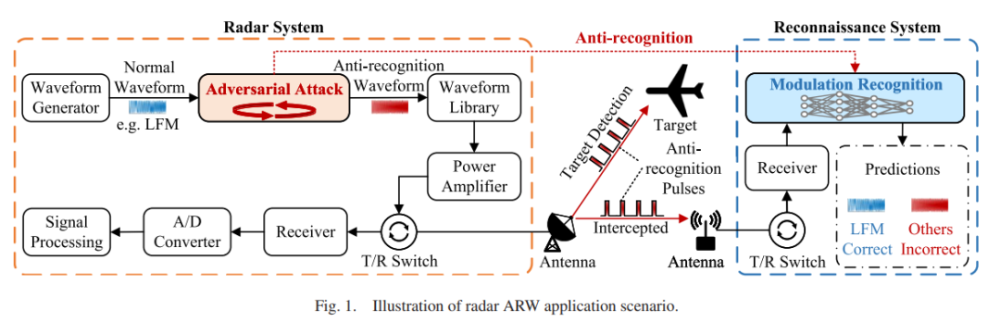
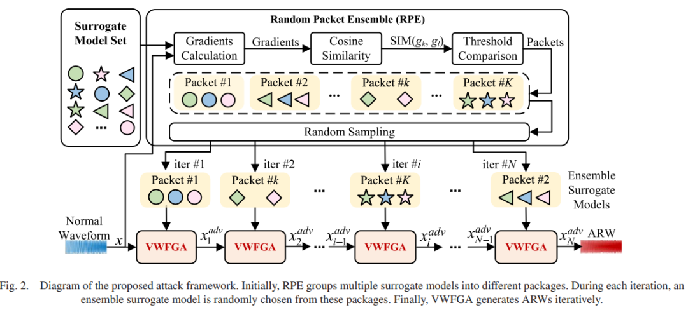
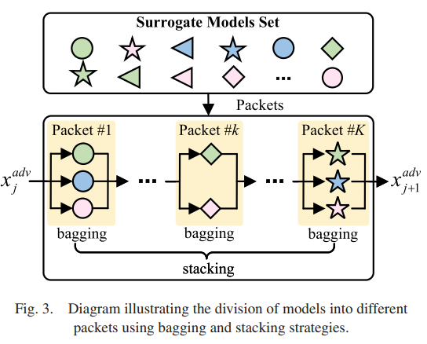
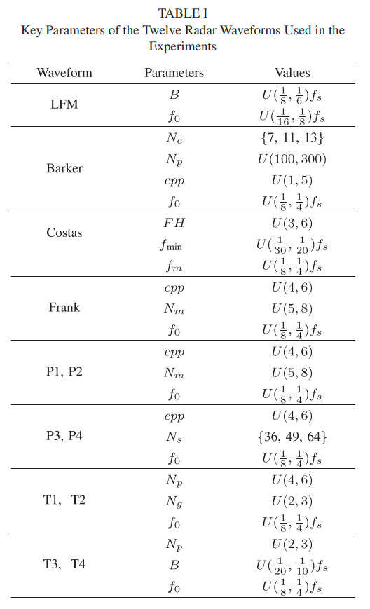
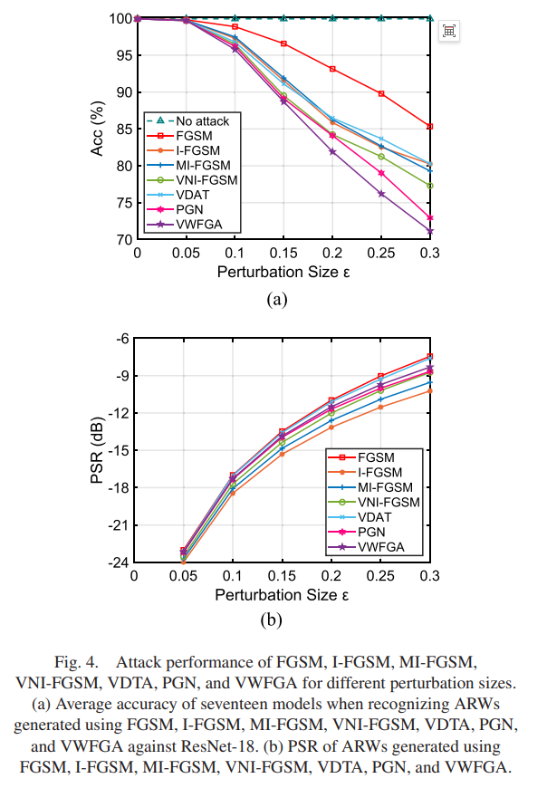
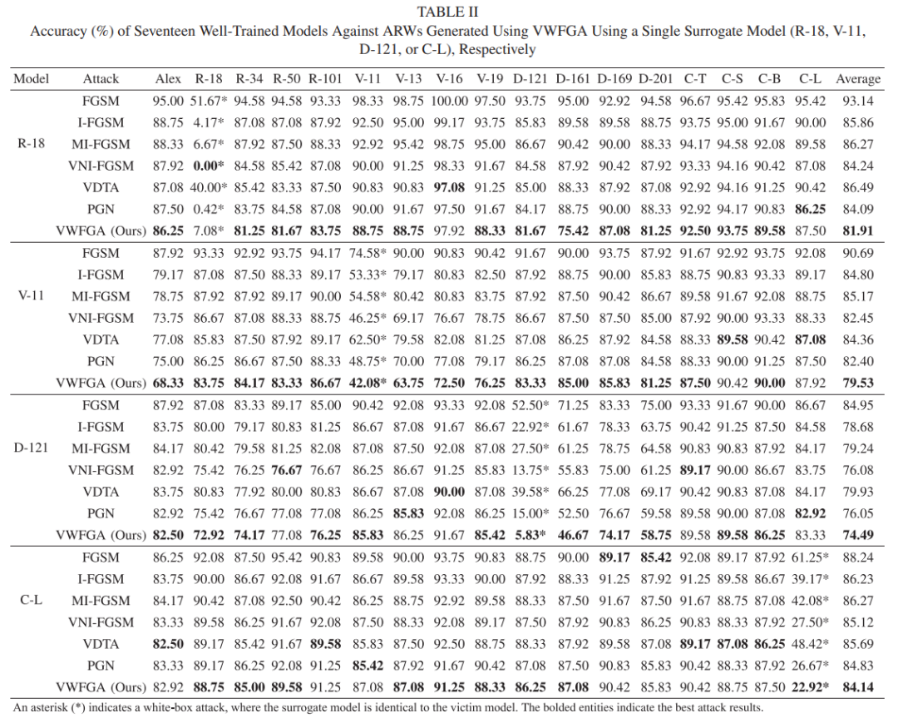
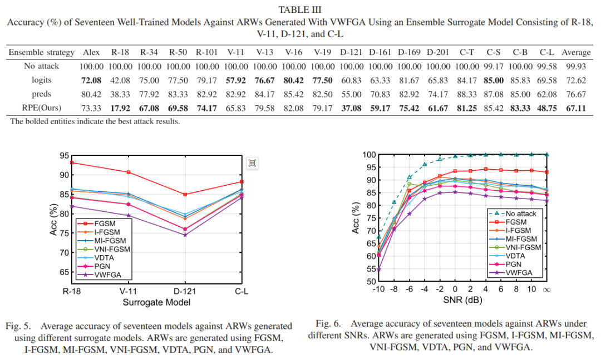
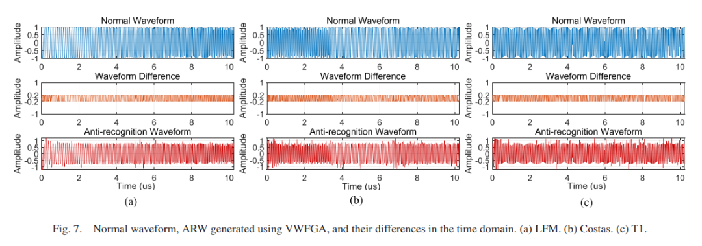
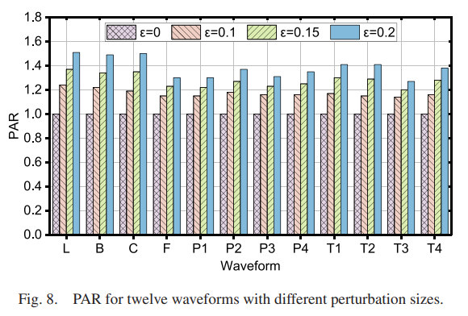
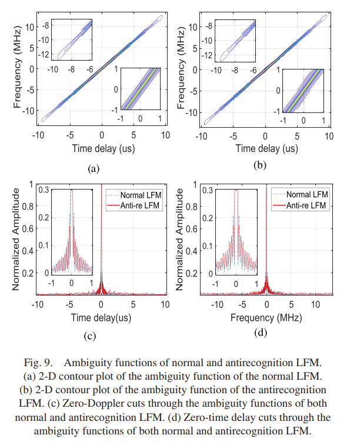

# New Approach to Radar Countermeasures: Designing Transferable Anti-Recognition Waveforms Based on Countermeasure Attacks[With Python Code, No Dataset]

New Approaches to Radar Combat: Designing Transferable Anti-Recognition Waveforms Based on Adversarial Attacks
1. Research Background and Motivation
However, in radar countermeasure scenarios, this technology faces three unique challenges:
Perturbation must be transmitted in the form of waveforms: unlike directly modifying pixel values in the image domain, radar jamming requires embedded transmission waveforms to propagate into the opponent's receiving system through space.
Black-box transferability must be achieved: We cannot know the internal structure and parameters of the adversary's network, but can only generate adversarial examples using a white-box proxy model and then transfer attack unknown black-box target models.
The work of the team from Beijing Institute of Technology is to propose a complete black-box adversarial attack framework under these three constraints, including two core modules: VWFGA (Variance Tuning and Weighted Forecasting Gradients Attack) and RPE (Random Packet Ensemble).
2 Problem Modeling: From an optimization perspective, the design paper on ARW is formulated as a constrained optimization problem. Assume the reference waveform is a known waveform with excellent autocorrelation and fuzzy function characteristics, such as LFM or Barker codes. The goal is to generate an adversarial waveform that satisfies:
The optimization objective is to minimize the negative value of cross-entropy loss (maximize the loss function, forcing the classifier to make mistakes), while the constraints ensure that the perturbed waveform is highly similar in amplitude to the original waveform. In this case, ARW degenerates into the original reference waveform; when increased, the attack becomes more aggressive but less covert.
The cleverness of this modeling approach lies in its balancing of the optimization objective against the enemy's recognition capabilities, while protecting our signal processing functions.
3 Core Method 3.1 VWFGA: Variance Tuned Weighted Forecast Gradient Attack VWFGA is a "double-layer iterative" optimization algorithm. The outer loop updates the current ARW, and the inner loop predicts the direction of future steps, providing forward information for the current gradient update.
Compared to existing methods (such as VNI-FGSM), VWFGA has three key improvements:
Variance tuning. Sampling data points within the neighborhood of the prediction step, calculating the gradient variance and introducing the update direction, helping ARW escape saddle points and suboptimal local minima. This operation is not directly applied to the current gradient, but embedded into the prediction process, guiding the future gradient direction to be more stable.
Adaptive step size. Replace the fixed step size with the normalized value of the current gradient magnitude:  
In regions with steep gradients (far from the optimal solution), the adaptive step size is larger; in regions with flat gradients (near the optimal solution), the step size automatically decreases. This strategy converges more efficiently than fixed step sizes under the same number of iterations.  
3.2 RPE: The Randomized Data Package Integrative Model (RPE) is a classic strategy for improving the transferability of adversarial examples. However, simply averaging the outputs of different models ignores the conflict between gradient directions—different models may point to completely opposite gradient directions for the same input, and direct averaging can lead to mutual cancellation of update directions.  
The solution to RPE is based on the cosine similarity of gradients to group the proxy models:  
When two models are grouped into the same data package, parallel attacks are conducted using Bagging strategy within the package; otherwise, they are grouped into different packages, executed sequentially using Stacking strategy. Additionally, at each iteration, a subset of all data packages is randomly sampled as the proxy model, maintaining model diversity while controlling computational costs to prevent ARW overfitting to individual proxy models.  
3.3 VTFA: The practical version in the code project includes the main attack method named VTFA (Variance Tuning and Flatness-Aware Attack), which is an engineering implementation of VWFGA's idea. VTFA contains three pluggable modules:  
MFE (Multi-neighborhood Flatness Exploration): Calculates gradients in multiple neighborhoods of the current adversarial signal to capture the level of flatness of the loss terrain;  
VET (Variance-Enhanced Tuning): Computes variance for multi-neighborhood gradients to enhance the attack power in turbulent areas;  
ASS (Adaptive Step Size): Dynamically adjusts the size of perturbations at each step based on historical loss changes.
The ablation experiment can be shut down at any time by Party B (e.g., --experiment wo_mfe) to facilitate researchers in evaluating the independent contributions of each component.
The data described in the paper does not match the actual data used for coding. The dataset used in the paper includes 12 classes of radar emission waveforms (LFM, Barker, Costas, Frank, P1-P4, T1-T4), with detailed definitions of each waveform parameter in Table I: sampling frequency 100 MHz, pulse width 10.24 μs, 1024 sample points per pulse, IQ two channels, SNR range from -10 dB to 10 dB, generating 1000 samples for each condition, and a total of 144,000 samples in the dataset.
The code actually loads data for 9 types of radar active interference signals (directNoise, noiseAmplitude, noiseFrequency, noiseConv, noiseMulti, falseTarget, noiseISDJ, noiseISRJ, noiseISLJ), with 250 training samples per class and 50 test samples per class, each with 4000 point IQ sampling, stored in the format .mat in the ../datasets/data2dCNN/TF_image/ directory.
The simulation parameters and generation codes for these 9 types of interference signals are not included in the open source repository. Information directly extracted from the code is limited to the normalization scaling factors for each class (e.g., noiseConv class needs to be divided by 100.0, directNoise class needs to be divided by 2.0), as well as file naming and directory structure.
Recommended paths to obtain data:
1.
If the 12-class waveform data described in the paper is used, it is necessary to rewrite the data loading logic in core/dataset.py (mainly adjusting sample allocation, changing signal length from 4000 to 1024, changing number of classes from 9 to 12, and removing class_scale_factors), but the core code of the attack framework (VWFGA/VTFA algorithms) can be directly reused.
6 Key experimental results The black-box attack experiment on 17 target models using RPE integrated with four proxy models: R-18, V-11, D-121, C-L under ideal noiseless conditions shows that the average recognition accuracy under three integration strategies (RPE, logits integration, predictions integration) are respectively 67.11%, 72.62%, and 76.67%. Compared to the no-attack baseline (99.93%), RPE decreases accuracy by 32.82%, and it is superior to the second-best logits integration strategy by 5.51 percentage points.
In the noise robustness analysis, when SNR is above 0 dB, the performance of all attack methods is slightly negatively correlated with the noise level, but the maximum performance difference between ARW with and without noise does not exceed 5.61%, indicating that the generated ARW has certain robustness against channel noise.
In the pulse Doppler (PD) radar and synthetic aperture radar (SAR) echo processing verification, the pulse compression results of ARW are highly consistent with normal waveforms (peak sidelobe ratios are -13.80 dB and -13.55 dB respectively). MTD processing can correctly detect the preset 4 targets, and the SAR point target imaging results also match the theoretical values. This proves that the adversarial perturbation has not destroyed the core signal processing functions of the radar.
7 Summary and Outlook
The method introduced in this paper has transferred the defense against attacks from the image domain to the radar waveform domain, providing a new technical route for "radar self-protection" in electronic countermeasures. The core idea—using small perturbations to deceive the opponent's recognition network while maintaining the capability of signal processing on one's side—is modeled as a constrained optimization problem in mathematics, solved with prediction gradients, variance tuning, and adaptive step sizes in algorithmic terms, and enhanced by an RPE packet integration strategy in engineering.
The current limitations of this work mainly lie in the significant performance gap between black-box and white-box attacks, as well as higher demands for algorithmic computational efficiency under real-time adversarial conditions. The author's team also points out that future advancements can be made in two directions: designing more high-performance transferable ARW generation methods, and developing efficient real-time ARW generation algorithms.
For researchers intending to reproduce this work, it is recommended to first confirm available data resources (either 12 types of waveforms or 9 types of interference signals are acceptable, and the algorithm framework is universal). Then, proceed step by step according to train.py → attack scripts. The implementation structure of each attack algorithm in the code repository is highly consistent, facilitating cross-comparison and module replacement.

## Images

<!-- PAYMENT_BLOCK -->

## Get this dataset

- Payment link (Stripe): [Buy now](https://buy.stripe.com/3cs8yP7sY87d0vu9AB)
- Payment QR code: 

<!-- /PAYMENT_BLOCK -->
